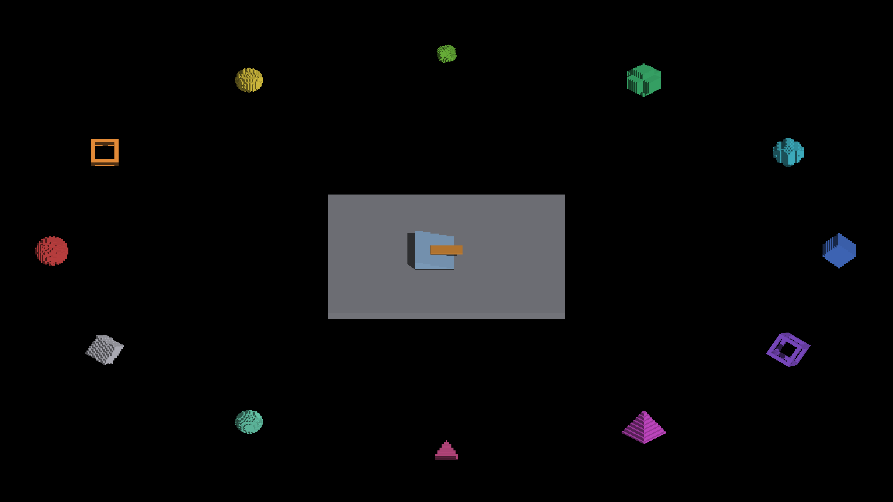

# Post-visibility sunlight query work

The opt-in diagnostic counts work actually reached by attached per-axis surface
lighting after visibility rejection. **All 21 native off/on RGB comparisons
are identical.** No shadow geometry, bias, blur, or production defaults change.
This is measurement infrastructure, not a demonstrated performance improvement.

## What is measured

Enable all three environment switches with the launcher:

```bash
fleet-run --env IR_PERAXIS_SURFACE_LIGHTING=1 \
  --env IR_PERAXIS_VISIBILITY_PREPASS=1 \
  --env IR_PERAXIS_VISIBILITY_STATS=1 \
  IRShapeDebug --sdf-voxel-scene baked --sdf-voxel-blockers --no-ao \
  --yaw 0.7853981633974483 --zoom 4 --auto-profile 200
```

`SUN-QUERY-PROBE` reports the **single 180th eligible per-axis draw** (one per
frame in these fixtures), not an accumulated total. With multiple eligible
canvases it describes only that draw. It counts each executed cascade query, so a receiver blending
cascades can contribute twice. It covers per-axis regular and overflow replay;
SDF presentation, detached receivers, and compute-lighting queries are not
instrumented. Direct-SDF fixture counts below describe its attached voxel
receivers, not the whole SDF lighting path.

| Field | Meaning |
|---|---|
| `cascades` | Calls to the shared cascade sampler |
| `indexed` | Sun-facing queries into complete candidate lists |
| `candidates` | Candidate records actually visited, stopping at the first blocker |
| `face_misses` | Finite-face degeneracy or closed-footprint rejection; excludes depth rejection and analytic-shape misses |
| `shape_candidates` | Analytic records visited, counted separately from finite faces |
| `blocked` | Queries terminated by an exact candidate hit; excludes fallback-map hits |
| `first_blocker_visits` | Sum of one-based visit positions for those hits; divide by `blocked` for the mean |
| `exhausted` | Complete lists scanned without a blocker, including empty local lists |
| `incomplete` | In-bounds lists rejected by completeness/budget guards |
| `outside` | Surface receivers outside the index domain, when the global source pool is nonempty |
| `valid` | Zero if any query counter overflowed; discard all query totals in that case |

An empty global source pool bypasses indexed queries. Non-surface receivers and
sun-facing gates can bypass them too; the fields are not a partition of all
fragments. Existing `VISIBILITY-PROBE` fields retain their meaning.

The diagnostic uses a separately compiled fragment program for **both** prepass
and replay. Ordinary programs compile without query state or counter writes.
The existing borrowed visibility buffer carries ten extra counters and a sticky
overflow marker. All-ones initialization stores count minus one, including an
untouched zero count. Readback synchronizes the GPU only in diagnostic mode.
Do not use these runs' timings to compare optimizations.

## Native observations

Metal Debug on Apple M4 Max, macOS 26.5.2; offscreen 2560×1440 output, internal
framebuffer 1284×722. Shape fixtures use yaw 45°; the mixed fixture uses 73.125°.
The mixed fixture is `shadowocclusion,orbit,floor` with a GRID staircase,
frozen objects and camera, base subdivision one. Each row is one sampled frame.

| Fixture | Zoom | Queries | Visits | Face misses / visits | Mean first blocker visit |
|---|---:|---:|---:|---:|---:|
| Direct SDF + voxel receivers | 1 | 9,266 | 533,430 | 96.69% | 60.06 |
| Direct SDF + voxel receivers | 4 | 148,240 | 3,509,616 | 93.17% | 24.75 |
| Baked voxels | 1 | 8,305 | 481,337 | 97.93% | 41.54 |
| Baked voxels | 4 | 132,601 | 3,205,374 | 94.99% | 19.53 |
| Mixed | 1 | 9,832 | 414,756 | 95.43% | 32.63 |
| Mixed | 4 | 85,338 | 1,264,602 | 85.76% | 13.13 |

Every row has `valid=1`, `incomplete=0`, and `outside=0`. The baked no-shadows
control reports ten zero counters and `valid=1`. Analytic visits occur in the
direct fixture; baked and mixed rows have none. Candidate reservation order can
vary between GPU runs, changing visit counts and blocker positions without
changing visibility. These are workload observations, not stable benchmark
thresholds or evidence of dense/incomplete-tile behavior.

The high miss fraction supports testing more selective candidate indexing next.
It does not prove that another per-candidate arithmetic branch will be faster:
the earlier [rejection experiment](../../../perf/finite-shadow-query-pruning.md)
already failed to demonstrate a gain. Compare reduced candidate fetches against
index-build time, memory, and incomplete-list frequency; preserve the unchanged
exact footprint/depth test. Time proposed changes with diagnostics disabled.

## Images and checks

| Scene | Off/on pairs | Changed RGB pixels |
|---|---:|---:|
| Direct shape fixture: cardinal/inter-cardinal views and zoom 2 | 6 | 0 |
| Baked shape fixture: same views | 6 | 0 |
| Mixed scene: nine yaw steps through a full turn | 9 | 0 |

[comparison.json](comparison.json) records full-image comparisons without
alignment, masking, resampling, or tolerance. All images are retained. These
prove diagnostic parity, not a new independent geometry oracle. Coarse floor
sampling and orbit-object banding remain visible in both arms; this change does
not claim to repair them.

| Diagnostics off | Diagnostics on |
|---|---|
|  |  |
|  |  |

The counter suite executes both shader implementations with known inline/spill
lists, first/last blockers, footprint and depth misses, incomplete lists, empty
pools, both cascades, and analytic classification. Removing any counter fails a
positive control. Publication checks exercise visibility rejection, zero values,
initial sentinel wrap, exact overflow, overshoot, and sticky invalidity. Runtime
routing checks cover shader selection, allocation, borrowed bindings, and decoded
readback fields. Host atomics are serial adapters; native OpenGL remains untested.

[manifest.json](manifest.json) retains commands, source/binary/staged-shader
hashes, query totals and screenshot mapping. Each case has its full gzip-compressed log and an
excerpt; [capture-controller.txt](capture-controller.txt) records the sequential
launcher. The source was dirty at the recorded base; the final face-miss edit
only indents counter increments. Source/staged hashes agree for the captured
version. A failed sandboxed display launch and a lock-wait timeout were resolved
before this successful 13-run batch; neither produced accepted evidence.
