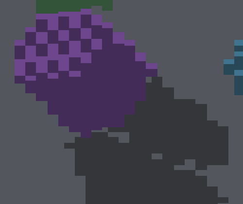
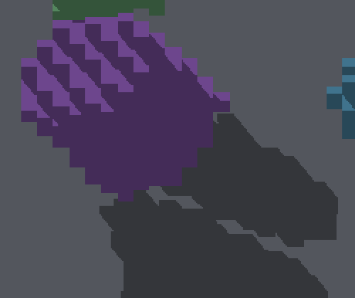

# Tilted baked-shadow attribution

The apparent isolated hole beneath the purple cylinder is a genuine opening
between **two casters**: the cylinder and torus. Face-center receiving quantizes
that narrow channel to whole lit floor faces. Continuous surface receiving
preserves its shape; it must not be filled or blurred away.

| Face-center receiver | Continuous surface receiver |
|---|---|
|  |  |

Native, unresampled ROI: x=900, y=650, width=500, height=420. Both runs disable
AO and local lights and use identical geometry, sun and camera. Full six-view
captures are in `face-sun/`, `surface-sun/` and the `no-shadow/` control.

## Independent geometry check

`SdfBakePool.TiltedCylinderAndTorusLeaveARealChannelBetweenTheirShadows`
bakes all four actual primitives, attaches their assets to pools and executes
the production GRID inverse rebuild. The occupied destination counts are
386 sphere, 625 cylinder, 230 cone and 215 torus. Four external blockers add
24 unit boxes. Double-precision ray/slab intersections then operate on those
boxes without using the renderer's projection, face masks, candidate index
or finite-face query. This is a test oracle, not a runtime rendering path.

| Floor receiver | Geometric result | Native yaw45 screenshot |
|---|---|---|
| (2.5, -14.5, 5.5) | Clear of all casters | Pixel (1223,972): lit, RGB (83,86,93) |
| (3.5, -14.5, 5.5) | Cylinder blocks | Pixel (1200,972): RGB (52,54,58) |
| (1.5, -14.5, 5.5) | Torus blocks | Pixel (1246,972): RGB (52,54,58) |
| (2.5, -15.5, 5.5) | Cylinder blocks | Pixel (1223,983): RGB (52,54,58) |

The no-shadow control reads (83,86,93) at all four pixels. Both receiving modes
agree at these sample locations. The test also checks two points either side
of the clear ray and a torus-blocked point at y=-13.4. Adding a box at (6,-6,2)
must block the clear ray, providing a positive control for occupancy changes.
`receiver-probes.json` records the native RGB reads. The continuous projection
uses world-origin screen center (1280,720), iso scales (16,8), and yaw45.

## Discriminating experiments

All diagnostic shader edits were restored; no shader changes ship here.

- **Expose every rotated-cell face:** the yaw45 floor gap is unchanged.
  A few self-shadow pixels change, so this is not a global equivalence claim.
- **Bypass tile lists:** scan the complete finite record pool. All six RGB
  frames match the original parented captures exactly. Candidate omission does
  not explain this case.
- **Widen face-coordinate acceptance to [-0.001,1.001]:** the yaw45 frame is
  unchanged. Three other views change slightly. This deliberately inflated
  diagnostic is rejected, not a proposed shadow fix.

`experiments/` retains the three temporary source patches, logs and yaw45
full frames. The original baseline is in
[the parent pose controls](../sdf-baked-transform-controls/README.md).
The older observation of an unexplained gap is superseded by this attribution.

## Shipped controls and scope

ShapeDebug's `--surface-lighting` exposes the existing experimental per-axis
surface receiver without requiring an environment override. The isolated
SDF/voxel scene now honors `--no-local-lights`; before this change it always
created an emitter. Six sun-only surface references extend the render gate.
The ordinary default scene and its face-center references stay unchanged.
The flag only affects eligible per-axis faces. Cardinal views retain their
existing receiver and are pixel-identical between the two sun-only runs;
the continuous comparison applies to yaw45 at zoom4 and zoom2.

Commands:
```sh
fleet-run IRShapeDebug --sdf-voxel-scene baked --sdf-voxel-pose parented --sdf-voxel-blockers --no-local-lights --no-ao --auto-screenshot 10
fleet-run IRShapeDebug --sdf-voxel-scene baked --sdf-voxel-pose parented --sdf-voxel-blockers --surface-lighting --no-local-lights --no-ao --auto-screenshot 10
fleet-run IRShapeDebug --sdf-voxel-scene baked --sdf-voxel-pose parented --sdf-voxel-blockers --surface-lighting --no-local-lights --no-ao --no-shadows --auto-screenshot 10
```

Native macOS / Apple M4 Max / Metal / Debug, 2560×1440 framebuffer,
1280×720 game resolution. Four posed baked subjects, four voxel blockers,
one floor, zero local lights; sun direction proportional to (0.35,0.85,-0.4).
Shot targets: yaw0/45/90/180/270 at zoom/subdivision4, yaw45 at zoom/subdivision2.
Origin pivot; logs retain actual applied yaw. The clipped far shadows meet the
finite floor boundary.

This resolves attribution of the specific gap, not every self-shadow artifact.
Continuous receiving remains opt-in: its wider-view GPU cost was already
measured as substantially higher in
[the earlier surface-lighting work](../peraxis-surface-lighting/README.md).
No new throughput claim, default change, Windows validation, fog-path change,
caster inflation, extra tracing or blur is included.

## Validation

IRShapeDebug and IrredenEngineTest built successfully on macOS Metal Debug.
The SDF bake/GRID surface test filter passed all 12 tests, and both Python
SDF control tests passed. Header/shader checks, comment-reference lint,
formatting and diff checks passed.

Render verification completed successfully: **80 checks passed**. All six
new sun-only references and all twelve existing baked-pose references matched
exactly; other scenes passed their existing tolerances. No existing references
or tolerances were replaced. The complete result is in `render-verify.log.gz`
(job `20261016T044835Z-render-verify-b8fded`). Five reuse/cleanup scans returned no findings.
